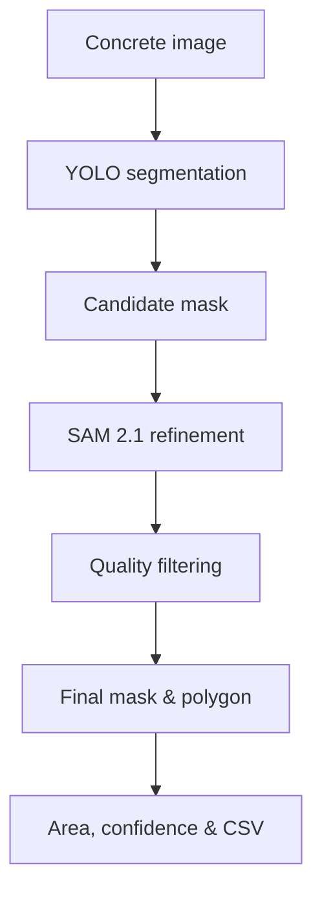

# Concrete Crack Segmentation with YOLO & SAM

> 콘크리트 균열을 픽셀 단위로 탐지하고, YOLO의 빠른 예측과 SAM의 경계 보정을 결합한 컴퓨터 비전 프로젝트


김주형 · 단국대학교 토목환경공학과  
Civil Engineering × Computer Vision

[핵심 결과](#핵심-결과) · [실험 비교](#experiments) · [노트북](#notebooks) · [실행 방법](#quick-start)

## 핵심 결과

**균열 세그멘테이션 학습·추론과 YOLO → SAM 후처리를 구현한 연구 프로젝트입니다.** 현재 정량 결과는 YOLO11s 실험 중심이며, SAM 보정의 성능 향상은 별도 비교 실험이 필요합니다.

| 실행 | 최고 Mask mAP50-95 | 마지막 epoch Mask mAP50-95 |
|---|---:|---:|
| s10 | 0.1538 | 0.1538 |
| s50 | 0.2450 | 0.2419 |
| s100 | 0.2453 | 0.2385 |

최고값은 각 실행에서 Mask mAP50-95가 가장 높은 epoch를 선택한 값입니다. **s50과 s100의 최고값 차이는 0.0003(0.03%p)**입니다. 반복 실험과 동일 테스트셋 재평가가 없어 이 차이를 통계적으로 유의한 우위로 해석하지 않습니다. 수치는 제공된 실험 요약 표를 옮긴 것으로, 원본 CSV 대조와 epoch 번호 확인이 남아 있습니다.

## Project Overview

시설물 균열 점검에서는 균열의 존재뿐 아니라 위치, 형태, 연속성 및 면적을 정밀하게 파악해야 합니다. 이 프로젝트는 콘크리트 이미지에서 균열을 인스턴스 세그멘테이션하고, 후처리 결과를 정량 분석 및 수동 검수 가능한 형태로 저장하는 파이프라인을 구축합니다.

핵심 목표는 다음과 같습니다.

- YOLO11·YOLO26 모델의 균열 세그멘테이션 학습 및 비교
- YOLO 예측 마스크를 SAM 2.1로 보정
- 균열별 신뢰도와 픽셀 면적 산출
- 비교 오버레이와 YOLO polygon 라벨 자동 생성
- Google Colab과 Drive 기반의 재현 가능한 학습·추론 환경 구성

## Pipeline



YOLO가 균열 후보를 빠르게 찾고, SAM이 해당 후보 주변에서 경계를 다시 추정합니다. SAM 결과가 YOLO 마스크와 지나치게 다르면 IoU·면적비 조건으로 제외하여 콘크리트 배경 전체가 선택되는 오류를 줄입니다.

## Key Features

| 기능 | 내용 |
|---|---|
| Model training | YOLO11 및 YOLO26m 균열 세그멘테이션 학습 |
| Model inference | 단일 이미지 업로드, 마스크·박스·신뢰도 시각화 |
| SAM refinement | YOLO 마스크를 prompt로 사용한 SAM 2.1 경계 보정 |
| Quality control | 최소 면적, IoU, 면적비 기반 후보 필터링 |
| Quantification | 균열별·전체 픽셀 면적과 이미지 대비 면적비 산출 |
| Label export | Roboflow 수정용 YOLO polygon 라벨과 ZIP 생성 |
| Reproducibility | Colab, Google Drive, 고정 seed 기반 실행 흐름 |

## Experiments

| 모델 | 입력 크기 | 학습 설정 | 용도 |
|---|---:|---|---|
| YOLO11s-seg | 640 | 10·50·100 epochs | epoch 증가에 따른 성능 비교 |
| YOLO11m-seg | 640 | 50·100 epochs | 모델 크기 변화 비교 |
| YOLO26m-seg | 1024 | 최대 250 epochs, patience 50 | 고해상도 균열 학습 |
| YOLO + SAM 2.1 | YOLO 1280 / SAM 1024 | 마스크 기반 refinement | 경계 보정 및 라벨 생성 |

### YOLO11s Epoch Ablation

동일한 YOLO11s-seg 계열에서 학습 epoch를 10·50·100으로 늘렸을 때의 결과입니다. 아래 최종값은 각 실행의 마지막 epoch에서 추출한 수치입니다.

#### Final-Epoch Segmentation Metrics

| Run | Input | Epochs | Mask Precision | Mask Recall | Mask mAP50 | Mask mAP50-95 |
|---|---:|---:|---:|---:|---:|---:|
| s10 | 640 | 10 | 0.6890 | 0.5259 | 0.4753 | 0.1538 |
| s50 | 640 | 50 | 0.7498 | **0.6593** | **0.6768** | **0.2419** |
| s100 | 640 | 100 | **0.7808** | 0.6463 | 0.6685 | 0.2385 |

<details>
<summary>박스 지표·최고 epoch·상대 향상률 상세 보기</summary>

#### Final-Epoch Bounding-Box Metrics

| Run | Box Precision | Box Recall | Box mAP50 | Box mAP50-95 |
|---|---:|---:|---:|---:|
| s10 | 0.7825 | 0.6148 | 0.6381 | 0.4131 |
| s50 | 0.7659 | **0.7632** | 0.7948 | 0.6122 |
| s100 | **0.8807** | 0.7296 | **0.8233** | **0.6291** |

#### Best Checkpoint by Mask mAP50-95

| Run | Best epoch | Mask Precision | Mask Recall | Mask mAP50 | Mask mAP50-95 |
|---|---:|---:|---:|---:|---:|
| s10 | 11* | 0.6890 | 0.5259 | 0.4753 | 0.1538 |
| s50 | 48 | 0.7910 | 0.6166 | 0.6628 | 0.2450 |
| s100 | 95 | **0.8017** | **0.6518** | **0.6894** | **0.2453** |

\* 실험 요약 코드가 출력한 epoch 번호를 그대로 기록했습니다. 원본 `results.csv`의 indexing 방식은 최종 정리 전에 다시 확인할 예정입니다.

#### Improvement over s10

| Run | Mask Precision | Mask Recall | Mask mAP50 | Mask mAP50-95 |
|---|---:|---:|---:|---:|
| s50 | +14.81% | +17.25% | +39.44% | +59.37% |
| s100 | +16.36% | +23.94% | +45.04% | +59.52% |


</details>

**Interpretation.** 10→50 epochs에서 Mask 성능이 크게 향상됐습니다. 50→100 epochs에서는 최고 체크포인트의 Mask mAP50-95가 0.2450에서 0.2453으로 거의 정체된 반면, Mask mAP50과 Precision은 추가로 개선됐습니다. 이 실행들에서는 최고 Mask mAP50-95의 추가 증가가 작았습니다. 학습 비용은 별도로 측정되지 않았으며, 모델 선택에는 동일 조건 재평가와 Recall 요구 수준을 함께 고려해야 합니다.

#### Preliminary YOLO11m Reference

별도로 제공된 YOLO11m-seg 100-epoch 학습 그래프의 마지막 지점은 Mask Precision ≈0.75, Recall ≈0.64, mAP50 ≈0.66, mAP50-95 ≈0.23입니다. 이 값은 그래프에서 읽은 근삿값이므로 위 YOLO11s 실험 요약 표의 수치와 직접적인 최종 비교에는 사용하지 않습니다.
## Repository Structure

```text
YOLO/
├── notebooks/
│   ├── YOLO11_Crack_Model_Open_and_Test_Colab.ipynb
│   ├── YOLO26m_Crack_Training.ipynb
│   └── YOLO_SAM_Crack_Final_Process.ipynb
├── weights/
│   └── best.pt
├── requirements.txt
├── .gitignore
└── README.md
```

### Notebooks

| 노트북 | 역할 |
|---|---|
| [YOLO11 model test](notebooks/YOLO11_Crack_Model_Open_and_Test_Colab.ipynb) | 저장된 YOLO11 모델을 불러와 단일 이미지 예측 및 Drive 저장 |
| [YOLO26m training](notebooks/YOLO26m_Crack_Training.ipynb) | Roboflow 데이터셋 다운로드, YOLO26m 학습 및 최적 모델 검증 |
| [YOLO → SAM process](notebooks/YOLO_SAM_Crack_Final_Process.ipynb) | 여러 이미지의 YOLO 예측, SAM 보정, 결과·라벨 일괄 저장 |

## Quick Start

### 1. Google Colab에서 노트북 열기

위 [노트북 목록](#notebooks)에서 목적에 맞는 파일을 내려받아 Colab의 **파일 → 노트북 업로드**로 엽니다. GPU 런타임을 선택하고 설치 셀부터 순서대로 실행합니다. 비공개 저장소에서는 GitHub 링크로 바로 여는 방식이 계정 인증에 따라 제한될 수 있습니다.

### 2. 모델 경로 설정

저장소의 `weights/best.pt`를 Google Drive에 업로드한 뒤 노트북의 모델 경로를 수정합니다.

```python
YOLO_MODEL_PATH = "/content/drive/MyDrive/your_folder/best.pt"
```

### 3. 추론 설정 조정

```python
YOLO_CONF = 0.25
YOLO_IMGSZ = 1280
MIN_COMPONENT_AREA = 100
MIN_IOU = 0.50
MIN_AREA_RATIO = 0.50
MAX_AREA_RATIO = 2.00
```

### 4. 결과 확인

YOLO–SAM 파이프라인은 다음 결과를 생성합니다.

```text
results/
├── masks/
│   ├── yolo/
│   ├── sam_raw/
│   └── final/
├── comparison_overlays/
├── roboflow_dataset/
├── processing_summary.csv
└── processing_errors.csv
```

## Dataset

데이터셋은 Roboflow에서 관리하며 저장소에는 포함하지 않습니다.

- YOLO11 experiments: `university-bswxt / crack-uuw5e / version 8`
- YOLO26 experiments: `aos-workspace / erc2-59n5c / version 1`
- Task: instance segmentation
- Class: `crack`

데이터 사용 전 각 데이터셋의 공개 범위와 라이선스를 별도로 확인해야 합니다.

## Current Limitations

- 픽셀 면적을 실제 면적으로 환산하려면 기준 길이 또는 카메라 보정 정보가 필요합니다.
- SAM은 입력 prompt가 부정확하면 균열 주변 배경을 과도하게 선택할 수 있습니다.
- 서로 다른 모델의 공정한 비교를 위해 동일 test split 기반 재평가가 필요합니다.
- 구조적 위험도 평가는 균열 마스크만으로 확정할 수 없으며 전문가 판단과 현장 정보가 필요합니다.

## Next Steps

- [ ] YOLO11s·YOLO11m·YOLO26m 동일 조건 정량 비교
- [ ] 대표 성공·실패 사례 시각화
- [ ] 균열 폭·길이·연속성을 반영한 평가 지표 검증
- [ ] 실제 축척을 이용한 면적 및 폭 측정
- [ ] YOLO–SAM 보정 전후 성능 비교

## Security

Roboflow API 키나 기타 인증정보를 노트북에 직접 입력해 저장하지 않습니다. 실행 시 환경 변수 또는 보이지 않는 입력 방식을 사용하세요. 이미 노출된 키는 폐기하고 재발급해야 합니다.

## Disclaimer

본 저장소는 연구 및 교육 목적의 프로젝트입니다. 예측 결과만으로 시설물의 안전등급이나 보수 필요성을 확정해서는 안 됩니다.

## 다른 프로젝트

| 프로젝트 | 주요 내용 |
|---|---|
| [YOLO · 균열 세그멘테이션](https://github.com/DoubleDeep-ai/YOLO) | 토목 이미지의 균열 탐지·마스크 분석 및 SAM 후처리 |
| [CIFAR-10 · 오류 분석](https://github.com/DoubleDeep-ai/cifar10-error-analysis) | PyTorch CNN의 오분류·신뢰도·시드별 변동 분석 |
| [OSM · 캠퍼스 지도 분석](https://github.com/DoubleDeep-ai/osm-campus-map-analysis) | 공공 지도와 보행 네트워크의 공간정보 탐색 |

각 저장소는 독립된 프로젝트입니다. 비공개 저장소 링크는 접근 권한이 있는 계정에서 열립니다.
