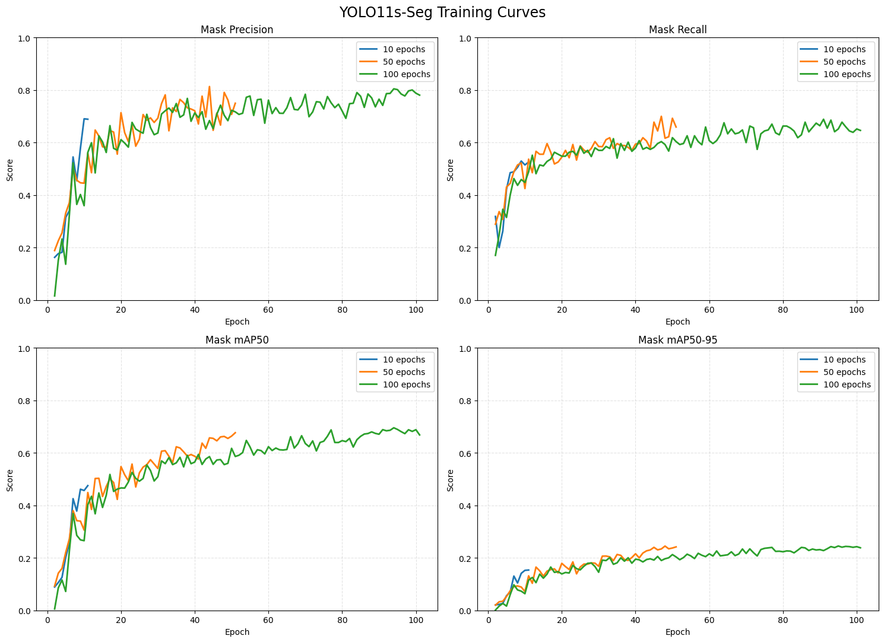
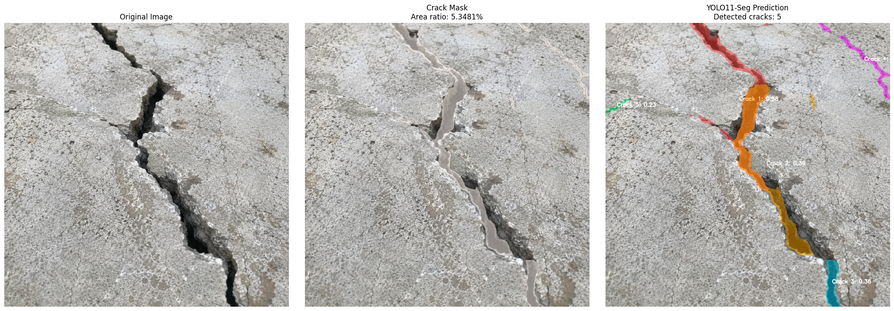

# 콘크리트 균열 세그멘테이션과 YOLO–SAM 자동 라벨링

## 왜 했는지

콘크리트 이미지에서 균열의 위치와 형태를 찾고, 예측 결과를 검수할 수 있는 라벨로 저장하려고 했다.

YOLO가 찾은 균열의 경계를 SAM으로 다듬으면 라벨 초안으로 쓸 수 있을지 궁금했다. 보정한 결과를 사람이 검수하는 방식으로 연결해 봤다.

## 한 것

- YOLO11s-seg를 10·50·100 epoch로 학습해 비교했다.
- YOLO 마스크를 SAM 2.1 프롬프트로 넣어 경계를 보정하고, IoU·면적비로 걸러냈다.
- 보정한 마스크를 YOLO polygon 라벨로 바꿔 Roboflow 검수용으로 내보냈다.
- YOLO11m·YOLO26m도 학습했지만 같은 조건으로 비교한 결과는 아직 정리하지 못했다.

## 결과

각 학습 실행의 마지막 epoch에서 마스크 지표를 비교했다.

| 실행 | 입력 크기 | 학습 epoch | 마스크 정밀도 | 마스크 재현율 | 마스크 mAP50 | 마스크 mAP50-95 |
|---|---:|---:|---:|---:|---:|---:|
| s10 | 640 | 10 | 0.6890 | 0.5259 | 0.4753 | 0.1538 |
| s50 | 640 | 50 | 0.7498 | 0.6593 | 0.6768 | 0.2419 |
| s100 | 640 | 100 | 0.7808 | 0.6463 | 0.6685 | 0.2385 |

10→50 epoch에서 마스크 성능이 크게 올랐다.  
50→100 epoch에서는 정밀도만 올랐고 재현율과 mAP는 소폭 낮아져, 성능 향상은 거의 정체됐다.

10·50·100 epoch 학습의 마스크 지표 변화를 비교했다.

연속된 균열이 여러 인스턴스로 나뉘어 예측된 사례를 확인했다.

## 안 된 것과 한계

- SAM 보정 전후의 성능은 정량 비교하지 못했다.
- 모델 간 동일 test split 재평가는 하지 못했다.
- 기준 길이나 카메라 보정 정보 없이 픽셀 면적을 실제 면적으로 바꾸지는 못했다.
- SAM이 균열 주변 배경까지 선택할 수 있어, 자동 라벨은 검수 전 초안으로 다뤘다.

## 실행

- [YOLO11_Crack_Model_Open_and_Test_Colab.ipynb](notebooks/YOLO11_Crack_Model_Open_and_Test_Colab.ipynb): 저장된 YOLO11 모델로 단일 이미지를 예측하고 Drive에 저장했다.
- [YOLO26m_Crack_Training.ipynb](notebooks/YOLO26m_Crack_Training.ipynb): Roboflow 데이터를 받아 YOLO26m을 학습하고 최적 모델을 검증했다.
- [YOLO_SAM_Crack_Final_Process.ipynb](notebooks/YOLO_SAM_Crack_Final_Process.ipynb): 라벨 초안, 비교 이미지, Roboflow 검수용 ZIP을 저장했다.

Colab에서 GPU 런타임으로 실행했다. `weights/best.pt`를 Drive에 올리고 노트북의 모델 경로를 지정했다.

## 데이터

YOLO11: `university-bswxt / crack-uuw5e / version 8`  
YOLO26: `aos-workspace / erc2-59n5c / version 1`

코드 작성에 AI 도구를 보조로 활용했으며, 실험 설계와 결과 해석은 직접 수행했습니다.
